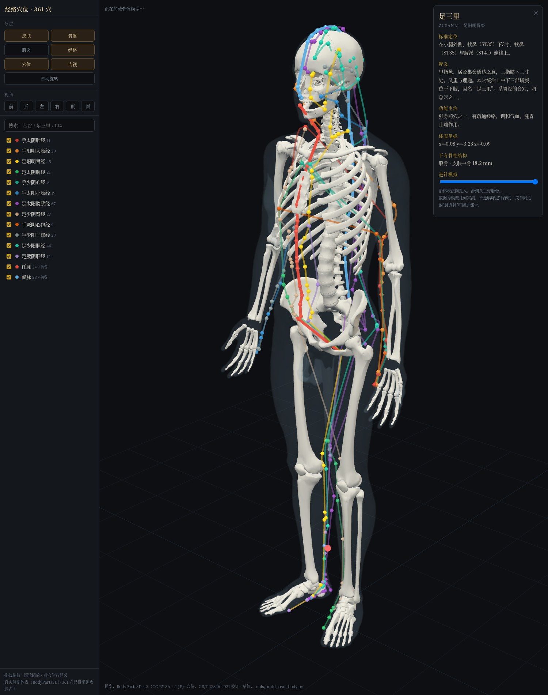
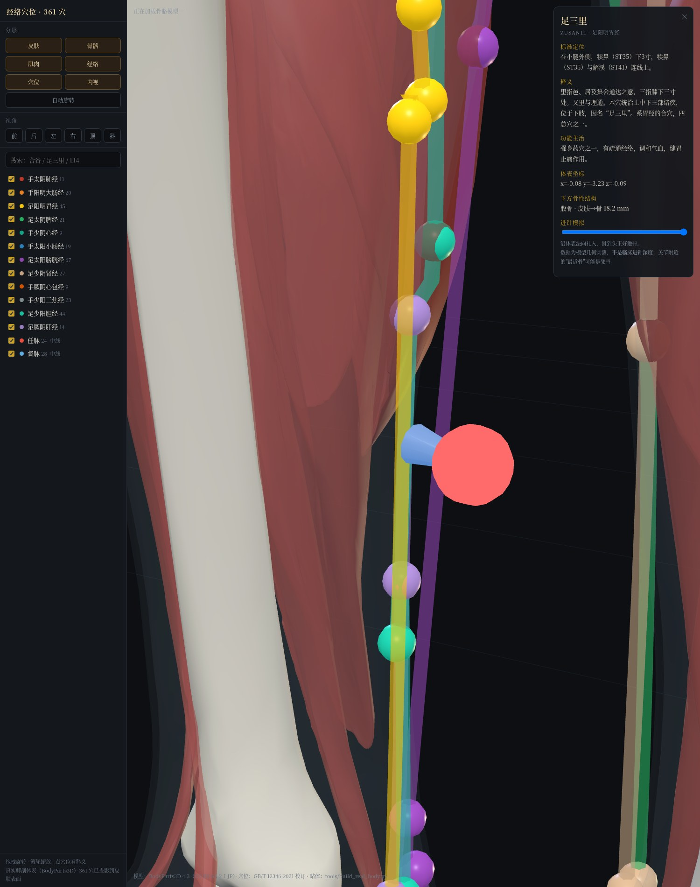
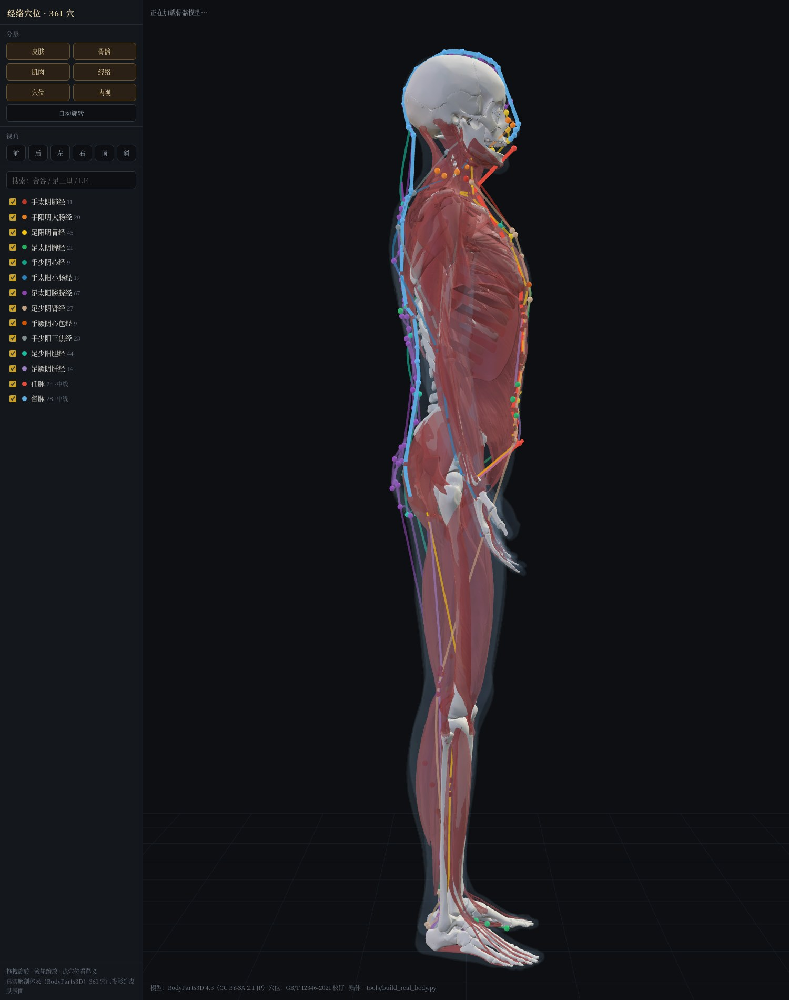

# 3D 人体经络穴位图谱 · 361 穴 + 真实解剖模型

> **真实人体解剖网格**（BodyParts3D：皮肤 10.2 万顶点 / 20.3 万面，骨骼 406 个部件，肌肉 125 个部件）
> ＋ **WHO/国标口径 361 穴、14 条经脉**（三维坐标、拼音、释义、功能主治、标准定位）
> ＋ 全部 361 穴**投影贴合真实皮肤表面**，任脉、督脉归正到前后正中线（x=0）。


## v1.2.0：把「木头人」换成真实解剖网格

上一版的人体是**程序化几何**（剖面放样 + 球关节 + 圆柱四肢）——比例对，但一眼就是木头人。
这一版直接换成真实解剖网格：

| 层 | 来源 | 规模 |
|---|---|---|
| 皮肤 | BodyParts3D `FJ2810` = FMA7163 Skin | **102,467 顶点 / 203,382 面**（含面部五官、手指、脚趾） |
| 骨骼 | BodyParts3D 骨骼部件 406 个 | 660,508 顶点 / 1,125,610 面 |
| 肌肉 | BodyParts3D 主要肌群 125 个 | 512,049 顶点 / 806,654 面 |

穴位贴体做了两件必须做的事：

1. **T-pose → 解剖学站姿**：上游穴位坐标是双臂平举，BodyParts3D 是垂手站立。
   顺序必须是「手臂穴位先绕肩关节转下来，再投影」——直接投影会把手臂穴位吸到躯干上。
2. **最近三角面投影**：361 穴投影到真实皮肤表面（用三角面重心预筛，把每点候选面从 20 万降到几百，
   否则单点要遍历 20 万面，361 点要跑十几分钟）。投影后：**均值偏差 15.0 mm、最大 86.3 mm**
   ——这是上游坐标自身的误差（手臂区最大），点本身已落在皮肤上。

复现校验（不靠看图，靠算）：

```bash
python3 tools/verify.py
# 穴位 361 / 经脉 14 / 任督 中线 x=0 / 到皮肤面距离 均值 0.040 最大 0.126 单位
# ✅ 全部通过：361 穴贴真实皮肤表面、任督归前后正中线、十四经穴数与 GB/T 12346-2021 一致
```



## v1.3.0：骨性标志 + 逐穴进针几何



每个穴位现在都带三项**从网格实测**的几何量（`data/needling.json`）：

| 字段 | 含义 |
|---|---|
| `normal` / `inward` | 该穴体表法向（进针方向，单位向量） |
| `bone_zh` / `bone_en` | 该穴下方/最近的骨性结构（如合谷→掌骨、膻中→胸骨、风池→枕骨） |
| `nearest_bone_mm` | 皮肤表面到该骨的最近距离 |
| `needle_to_bone_mm` | 沿进针方向射线打到**同一块骨**的距离（穿到别的部位一律不采信） |

> ⚠️ **这不是教材的「直刺 0.5~1 寸」**。教材刺灸深度是有出处的医学结论，本仓库没有可靠可引用来源，
> **不编造数字**。这里给的是可复现、可验算的几何量，界面上明确标注"非临床进针深度"。
> 取穴落在骨缝/关节处时，"最近的骨"可能是邻骨（如足三里正好在膝关节高度时最近骨为股骨远端），
> 这是几何事实，不是错误。

demo 里的表现：点任意穴位 → 详情卡显示「下方骨性结构 · 皮肤→骨 XX mm」，并在该穴沿法向画一根针
+ 红点标出触骨位置，滑杆控制进针深度。

### 同时修掉的两个数据级 bug

| 问题 | 表现 | 修法 |
|---|---|---|
| **贴体没按部位约束** | 合谷（手）被贴到**大腿外侧**——手垂在大腿旁时最近表面是腿 | 先用"离哪块骨最近"给 10.2 万皮肤顶点做部位标注（臂/腿/躯干/头 × 左右），手臂穴只贴手臂、腿穴只贴腿；肢体穴再保高度、只纠正环向。偏差 **均值 15mm/最大 86mm → 均值 2.6mm/最大 9.5mm** |
| **骨骼筛选把软组织当骨** | `iliotibial tract`（髂胫束）含 "tibia" 被当成胫骨、`fibular vein` 当腓骨、`maxillary gingiva` 当上颌骨 → "合谷下方是胫骨"这类荒唐结论 | 改成**词边界匹配 + 软组织黑名单**：406 部件 → **228 块真骨**，skeleton.glb 21.4MB → 12.0MB |

## v1.1.0 修掉的问题（仍然有效）

| 问题 | 原因 | 处理 |
|---|---|---|
| **任脉、督脉「飘在人体外」** | 上游坐标**正中线不在 x=0，而在 x≈+0.12**（任 24 + 督 28 穴全偏）；且原仓库只有点云、没有人体 | 中线归零；52 个中线穴强制 `x=0`；前侧贴胸腹、后侧贴背部 |
| 穴位位置缺乏体表约束 | 坐标没有表面可贴 | 全部投影到体表 |
| 两条腿叠在一起（看着像缺一条腿） | 左腿参数误用了右腿的 x | 双腿按 ±x 对称生成 |

## 数据规模（实数）

| 项 | 数量 |
|---|---|
| 经穴 | **361**（十二正经 + 任脉 + 督脉，与 GB/T 12346-2021 一致） |
| 经脉 | **14**（肺11 大肠20 胃45 脾21 心9 小肠19 膀胱67 肾27 心包9 三焦23 胆44 肝14 任24 督28） |
| 每穴字段 | 拼音 / 名称 / 经络 / 三维坐标 / 释义 / 功能主治 / 标准定位 |
| 在案修正 | **437 处**（对照国标逐条校订：错字、异体字、脏腑归属、定位表述、拼音大小写） |
| 坐标修复 | **361 穴**（中线归零 + T-pose 转换 + 贴真实皮肤；上游 id≥310 的 ×3 放大问题一并回正） |

## 演示

```bash
git clone https://github.com/Honglouqaz/tcm-meridian-3d && cd tcm-meridian-3d
python3 -m http.server 8080
# 打开 http://localhost:8080/demo/
```

- 分层：**皮肤 / 骨骼 / 肌肉 / 经络 / 穴位 / 内视**；视角：前·后·左·右·顶·斜；自动旋转
- 点穴位看释义、功能主治、标准定位、体表坐标；搜索「合谷」「足三里」「LI4」直接拉近
- 按经脉筛选（14 条经可分别开关），任脉、督脉标注「中线」
- 皮肤 3.7 MB 首屏加载；骨骼 21 MB、肌肉 16 MB **懒加载**（首次点开该层才下载）
- three.js r160 + GLTFLoader 随仓库自带，**离线可用**

## 坐标口径

```
y 向上，z 向前（腹侧），x 向右（人体左侧为 −x）
1 单位 ≈ 0.198 m   身高 8.67 单位 ≈ 1.72 m
```



## 目录

```
data/acupoints.json     361 穴真源（上游坐标，CC BY 4.0 原数据）
data/meridians.json     14 经脉穴位序
data/body.json          ★ 贴体后的 361 穴坐标 + 模型元信息（tools/build_real_body.py 生成）
data/needling.json      ★ 361 穴的体表法向 / 下方骨性结构 / 到骨距离（tools/build_needling.py 生成）
demo/index.html         three.js 单页演示（零构建）
demo/models/skin.glb     真实皮肤网格（3.7 MB）
demo/models/skeleton.glb 骨骼（21.4 MB，懒加载）
demo/models/muscles.glb  肌肉（15.8 MB，懒加载）
demo/vendor/            three.js r160 + GLTFLoader（自带，离线可用）
tools/build_real_body.py ★ 真实网格导入 + T-pose 转换 + 贴体投影 + GLB 导出
tools/build_needling.py   ★ 骨性标志 + 进针几何（法向 / 最近骨 / 沿法向触骨距离）
tools/verify.py           断言式校验（穴数 / 中线 / 贴面距离 / 模型完整性 / 解剖抽查）
tools/parse_acupoints.py  从原始 .lj 文本解析成 JSON
tools/shots.py            无头多视角截图（验收用）
docs/                   截图与字段说明
```

## 用途

做中医 App / 小程序 / 教学课件 / 3D 解剖可视化时，**不用再自己扒穴位坐标、也不用纠结"点悬空"**——
`fetch('data/body.json')` 拿到的坐标已经在真实皮肤表面上。

## 致谢与许可

- 解剖网格：**BodyParts3D 4.3**，© 日本 DBCLS（Database Center for Life Science），
  **CC BY-SA 2.1 JP**；衍生文件（`data/body.json`、`demo/models/*.glb`）同样以 CC BY-SA 2.1 JP 提供。
- 穴位数据：CC BY 4.0；定位表述按 **GB/T 12346-2021《经穴名称与定位》** 校订。
- 代码：MIT。详见 [DATA_LICENSE.md](DATA_LICENSE.md)。

## 免责

**不是医疗器械，不构成任何诊疗建议。** 针刺等属医疗操作，须由执业医师实施。详见 [DISCLAIMER.md](DISCLAIMER.md)。
