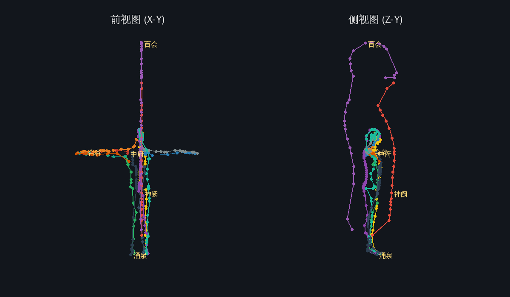

# 3D 人体经络穴位图谱 · 361 穴全量数据 + 可跑演示

> WHO/国标口径的 **361 个经穴、14 条经脉**，带三维坐标、拼音、释义、功能主治、标准定位，
> 另附一条独立分支线（膀胱经背二线），以及一个**打开就能转、能点、能搜**的 three.js 演示页。



## 数据规模（实数，非估计）

| 项 | 数量 | 说明 |
|---|---|---|
| 经穴 | **361** | 十二正经 + 任脉 + 督脉，与 GB/T 12346-2021 一致 |
| 经脉 | **14** | 肺11 大肠20 胃45 脾21 心9 小肠19 膀胱67 肾27 心包9 三焦23 胆44 肝14 任24 督28 |
| 分支线 | **1** | 足太阳膀胱经·背二线（14 穴），单列不并入主经 |
| 每穴字段 | 9 | `id / 拼音 / 名称 / 经络 / 三维坐标 / 释义 / 功能主治 / 定位` |
| 在案修正 | **437 处** | 对照国标逐条校订：错字、异体字、脏腑归属、定位表述、拼音大小写 |
| 坐标修复 | **88 穴** | 上游数据中 id ≥ 310 的穴位坐标整体放大 3 倍（漏除 /3），已全部修正回皮肤表面 |

## 演示

```bash
git clone <this-repo> && cd tcm-meridian-3d
python3 -m http.server 8080
# 打开 http://localhost:8080/demo/   （three.js 走 CDN）
```

- 左键拖拽旋转 / 滚轮缩放 / 右键平移
- 点穴位看释义、功能主治、标准定位
- 搜索「合谷」「足三里」「LI4」即时定位并高亮
- 按经脉筛选、一键只看某条经

## 目录

```
data/acupoints.json     361 穴唯一真源（CC BY 4.0）
data/meridians.json     14 经脉 + 1 分支线的穴位序（折线用它连线）
demo/index.html         three.js 单页演示（零构建，双击即开）
tools/parse_acupoints.py   从原始 .lj 文本解析成 JSON
tools/verify.py            对国标逐条复验（命中 0 不符才算过）
docs/                   截图与字段说明
```

## 用途

做中医 App / 小程序 / 教学课件 / 3D 解剖可视化时，**不用再自己扒穴位坐标**——
这是最费时间、最容易出错的一步。直接 `fetch('data/acupoints.json')` 就能开始。

## 免责

**不是医疗器械，不构成任何诊疗建议。** 针刺等属医疗操作，须由执业医师实施。详见 [DISCLAIMER.md](DISCLAIMER.md)。
数据来源与许可见 [DATA_LICENSE.md](DATA_LICENSE.md)。

## License

代码 MIT；数据 CC BY 4.0。
