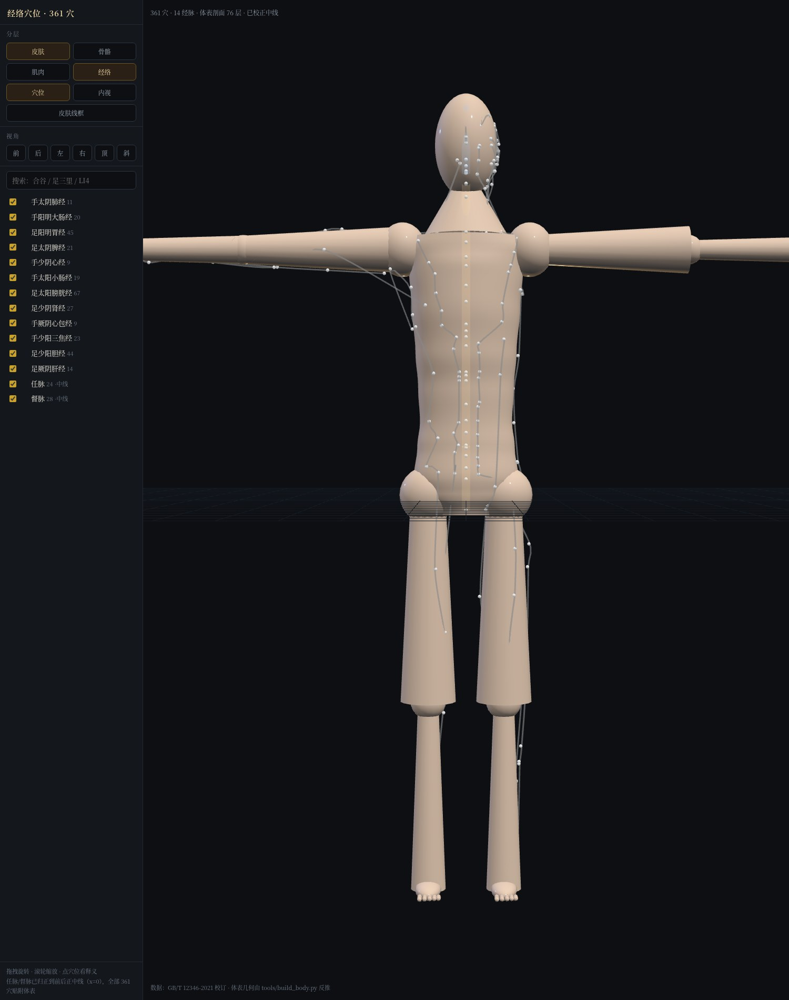

# 3D 人体经络穴位图谱 · 361 穴全量数据 + 可跑演示

> WHO/国标口径的 **361 个经穴、14 条经脉**，带三维坐标、拼音、释义、功能主治、标准定位，
> 以及一套**由穴位反推出来的人体体表**：皮肤 / 骨骼 / 肌肉 / 经络 / 穴位 五层可分别开关，
> 全部 361 穴投影贴在体表，任脉、督脉归正到前后正中线（x=0）。



## v1.1.0 修了什么（这次的重点）

| 问题 | 原因 | 处理 |
|---|---|---|
| **任脉、督脉「飘在人体外」** | 上游坐标的**正中线不在 x=0，而在 x≈+0.12**（任 24 + 督 28 穴全部偏移）；而且原仓库**根本没有人体**，只有点云，没有体表可贴 | 中线整体归零；按解剖标志重建平滑体表剖面；52 个中线穴强制 `x=0`，前侧贴腹胸表面、后侧贴背表面 |
| **穴位位置看着不对** | 坐标只保证「大致在那个位置」，没有体表约束 | 361 穴全部**沿截面方向投影到体表**（椭圆截面 / 手臂轴 / 腿轴），贴皮偏移 0.018 |
| **看不出穴位在身体哪一层** | 没有人体、骨骼、肌肉参照 | 新增**皮肤 / 骨骼 / 肌肉**三层程序化模型（脊柱·肋骨·肩胛·骨盆·四肢长骨·手足小骨 / 主要肌群），可单独开关 |
| **两条腿叠在一起**（视觉上像缺一条腿） | 左腿参数误用了右腿的 x | 双腿按 ±x 对称生成 |
| **背面穴位透出来像穿模** | 皮肤半透明在 three.js 里不写深度、且最后绘制 | 皮肤默认**不透明**；要看内部切「内视」（近乎全透） |
| **手、脚像被截断的圆柱** | 只有一段圆柱 | 补手掌五指、脚掌五趾，以及掌骨/跖骨 |

复现校验（不靠看图，靠算）：

```bash
python3 tools/verify.py
# ✅ 全部通过：361 穴贴体表、任督归中线、十四经穴数与 GB/T 12346-2021 一致
#   穴位 361 / 经脉 14 / 任督中线 52 / 离体表超差 0 / 身高 8.68 / 臂展 8.38 / 厚度 1.07
```


## 数据规模（实数，非估计）

| 项 | 数量 | 说明 |
|---|---|---|
| 经穴 | **361** | 十二正经 + 任脉 + 督脉，与 GB/T 12346-2021 一致 |
| 经脉 | **14** | 肺11 大肠20 胃45 脾21 心9 小肠19 膀胱67 肾27 心包9 三焦23 胆44 肝14 任24 督28 |
| 分支线 | **1** | 足太阳膀胱经·背二线（14 穴），单列不并入主经 |
| 每穴字段 | 10 | `id / 拼音 / 名称 / 经络 / 三维坐标 / 分区 / 释义 / 功能主治 / 定位` |
| 在案修正 | **437 处** | 对照国标逐条校订：错字、异体字、脏腑归属、定位表述、拼音大小写 |
| 坐标修复 | **361 穴** | 中线归零 + 全部投影到体表；上游 id ≥ 310 的坐标放大 3 倍问题一并回正 |
| 体表剖面 | **76 层** | 每 0.06 高度一层，含半宽 rx / 半深 rz / 截面中心 zc |

## 演示

```bash
git clone <this-repo> && cd tcm-meridian-3d
python3 -m http.server 8080
# 打开 http://localhost:8080/demo/    （three.js 已随仓库自带，离线可用）
```

- 左键拖拽旋转 / 滚轮缩放 / 右键平移；视角一键切 前·后·左·右·顶·斜
- 分层开关：**皮肤 / 骨骼 / 肌肉 / 经络 / 穴位 / 内视 / 皮肤线框**
- 点穴位看释义、功能主治、标准定位、体表坐标
- 搜索「合谷」「足三里」「LI4」即时定位并拉近
- 按经脉筛选；任脉、督脉在列表里标注「中线」

## 坐标口径（重要）

```
y 向上，z 向前（腹侧），x 向右（人体左侧为 −x）
1 单位 ≈ 0.196 m   身高 8.68 ≈ 1.70 m   臂展 8.38（T-pose 平举）
躯干厚度 ≈ 1.07（含胸腹前后径），头高 ≈ 0.92
```

体表不是随手画的：先取数据里的解剖标志（百会 3.00 / 承浆 2.08 / 天突 1.56 / 乳中 0.79 /
神阙 −0.47 / 曲骨 −1.10 / 会阴 −1.43 / 委中 −3.05 / 昆仑 −5.26 / 涌泉 −5.67）作为纵向标尺，
再按同高度穴位的横向、前后位置定出每一层的半宽与半深，用余弦缓动插值成 76 层剖面。
**为什么不用逐层统计包络**：实测相邻 0.12 高度上半宽能从 0.10 跳到 0.72，会把人做成薄片堆叠。

## 目录

```
data/acupoints.json     361 穴原始真源（上游坐标，CC BY 4.0）
data/meridians.json     14 经脉 + 1 分支线的穴位序
data/body.json          ★ 校正后的体表剖面 + 361 穴贴体坐标（tools/build_body.py 生成）
demo/index.html         three.js 单页演示（零构建）
demo/anatomy.js         程序化皮肤 / 骨骼 / 肌肉
demo/vendor/            three.js r160（自带，离线可用）
tools/parse_acupoints.py   从原始 .lj 文本解析成 JSON
tools/build_body.py        体表反推 + 穴位贴体（本版核心）
tools/verify.py            贴体/中线/穴数 断言校验（退出码 0 = 全过）
tools/shots.py             无头渲染多视角截图（用于验收）
docs/                   截图与字段说明
```

## 用途

做中医 App / 小程序 / 教学课件 / 3D 解剖可视化时，**不用再自己扒穴位坐标、也不用再纠结"点悬空"**——
直接 `fetch('data/body.json')`，坐标已经是贴体表的。

## 免责

**不是医疗器械，不构成任何诊疗建议。** 针刺等属医疗操作，须由执业医师实施。详见 [DISCLAIMER.md](DISCLAIMER.md)。
数据来源与许可见 [DATA_LICENSE.md](DATA_LICENSE.md)。

## License

代码 MIT；数据 CC BY 4.0。
